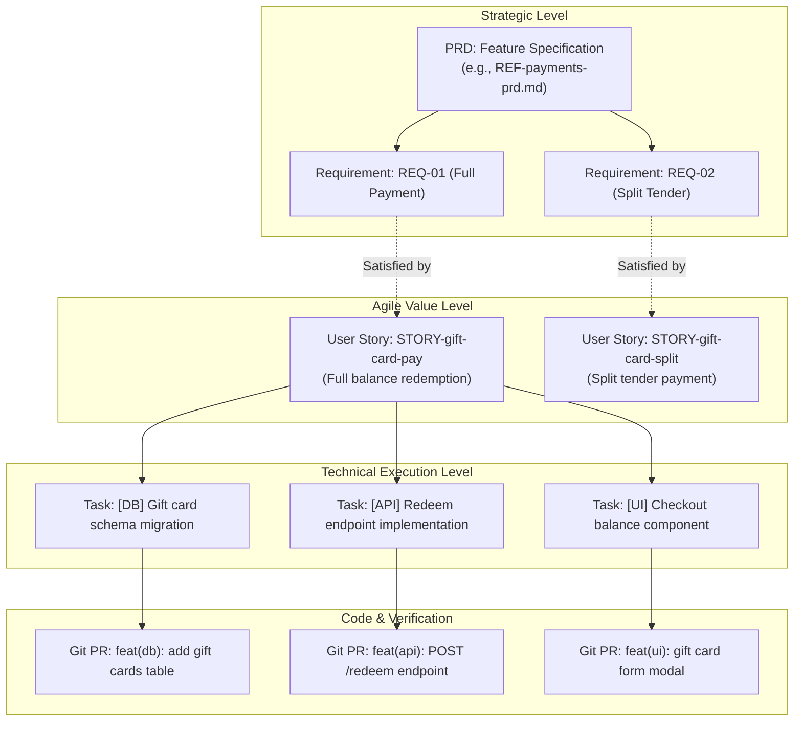

# Standard Software Industry Structures: PRD, User Story, and Task

**Document Type:** Industry Standards & Comparative Research  
**Author:** AI SDLC Research  
**Date:** October 2026  
**Status:** Approved Reference  

---

## Executive Summary

In professional software engineering, translating business objectives into shipping code relies on a three-tier decomposition hierarchy:
1. **PRD (Product Requirements Document):** Macro level — Strategic intent, customer problem, product behavior, success metrics, and boundaries (**The "Why" and "What"**).
2. **User Story:** Meso level — Vertical slices of end-user value, persona goals, and testable acceptance criteria (**The "Who", "What", and "Confirmation"**).
3. **Task (Engineering Task / Subtask):** Micro level — Concrete engineering work, architectural seams, schema changes, and pull request deliverables (**The "How" and Implementation**).

This document details canonical industry standards, authoritative frameworks (SVPG, Mike Cohn, Dan North, Bill Wake, Atlassian, Linear, Shape Up), exact structural schemas, practical templates, traceability models, and modern adaptations for AI-assisted software development lifecycles.

---

## 1. Product Requirements Document (PRD)

### 1.1 Purpose & Authority
A PRD articulates what problem a feature solves, for whom, how the product should behave from an outside-in perspective, and how success is measured.

* **Primary Authorities:**
  * **Marty Cagan / Silicon Valley Product Group (SVPG):** *Inspired: How to Create Tech Products Customers Love*. Cagan defines the PRD's purpose as addressing the four fundamental product risks before building: **Value risk**, **Usability risk**, **Feasibility risk**, and **Business Viability risk**.
  * **Lenny Rachitsky (Lenny's Newsletter):** Standardized modern lightweight 1-pagers used across Figma, Airbnb, Stripe, and Uber.
  * **Amazon Working Backwards (PR-FAQ):** Focuses on customer-centric clarity by writing the press release and FAQ first.
  * **Basecamp / Ryan Singer (*Shape Up*):** Replaces sprawling waterfall specs with "Pitches" defining problem, appetite, solution, rabbit holes, and no-gos.

### 1.2 Evolution: Waterfall vs. Modern Agile PRDs
* **Traditional Antipattern (Waterfall PRD):** 50+ page document produced in isolation, specifying every database field and UI button before discovery or development begins, obsolete before release.
* **Modern Best Practice (Living / Lean PRD):** 2–5 page collaborative document focusing strictly on the **Problem**, **User Outcomes**, and **System Behavior**, explicitly leaving technical architecture to engineering.

### 1.3 Standard Industry PRD Structure

| Section | Industry Standard Content | Why It Matters |
| :--- | :--- | :--- |
| **1. Header & Metadata** | Title, Owner/Author, Tech Lead, Designer, Status (Draft/In Review/Approved), Target Milestone/Release. | Establishes single-threaded ownership and document lifecycle state. |
| **2. Executive Summary / Context** | 2–3 sentence overview of the initiative. | Enables cross-functional stakeholders to grasp intent in 30 seconds. |
| **3. Problem Statement & Customer Insights** | The specific user pain point, customer quotes, quantitative drop-off data, user research findings. | Validates **Value Risk**; grounds the project in genuine human and market needs. |
| **4. Goals & Success Metrics (KPIs)** | Primary North Star metric, secondary guardrail metrics, direct OKR alignment. | Distinguishes shipping features from delivering business outcomes. |
| **5. Target Audience & Personas** | Primary persona(s), secondary persona(s), anti-personas (who this is NOT for). | Prevents designing for the generic "everyone" user. |
| **6. Out of Scope / Non-Goals** | Explicit list of what will deliberately NOT be built in this version/release. | The #1 mechanism to combat scope creep and preserve sprint velocity. |
| **7. User Flows & System Behavior** | Step-by-step user journeys, interaction patterns, wireframes/Figma mocks, edge/error states. | Validates **Usability Risk**; provides engineering with behavioral context. |
| **8. Functional Requirements** | Prioritized list of required capabilities (MoSCoW or P0/P1/P2), written as system obligations. | Foundation for traceability and automated test coverage. |
| **9. Non-Functional Requirements (NFRs)** | Performance SLAs (latency/throughput), security/auth, privacy/compliance (GDPR/SOC2), accessibility (WCAG), availability. | Validates **Feasibility & Viability Risks**; avoids late production surprises. |
| **10. Risks, Assumptions & Open Questions** | Unvalidated technical assumptions, third-party vendor limits, pending stakeholder decisions. | Surfaced early so spikes or discovery can resolve unknowns. |
| **11. Release & GTM Strategy** | Phased rollout (internal alpha, private beta, GA), feature flags, telemetry events, support docs. | Ensures operational readiness beyond code merging. |

### 1.4 Production Markdown Template: Modern PRD

```markdown
# [Feature Name] PRD

## Metadata
- **Author:** [Product Manager Name]
- **Engineering Lead:** [Tech Lead Name]
- **Design Lead:** [Product Designer Name]
- **Status:** Draft | In Review | Approved | Shipped
- **Target Release:** [e.g., Q4 2026 / Sprint 42]
- **Tracking Epic:** [e.g., PROJ-1024]

---

## 1. Problem Statement & Context
- **Customer Problem:** [Describe the exact problem users experience in plain English.]
- **Evidence & Data:** [e.g., 28% of cart drop-offs occur at checkout step 2; 45 customer support tickets in September.]
- **Strategic Fit:** [How this connects to company priorities or quarterly OKRs.]

## 2. Goals & Success Metrics
- **Primary Success Metric:** [e.g., Increase checkout completion rate from 62% to 70%.]
- **Guardrail Metric:** [e.g., Payment error rate must remain < 0.1%.]
- **Non-Goals:** [What we are explicitly NOT trying to solve here.]

## 3. Target Audience & Personas
- **Primary Persona:** [e.g., Casual Shopper making a one-time purchase.]
- **Secondary Persona:** [e.g., Support Agent issuing refunds.]

## 4. User Journey & Core Experience
- **Happy Path Flow:**
  1. User navigates to cart and clicks "Pay with Gift Card".
  2. User enters 16-digit card number and PIN.
  3. System validates balance and applies amount to order total.
- **Edge Cases & Failure Scenarios:**
  - Card expired or empty balance.
  - Partial balance coverage (split tender).
- **Design Link:** [Figma Canvas / Prototype URL]

## 5. Requirements

### Functional Requirements
- **FR-01 (Must/P0):** System shall allow users to redeem a valid gift card balance against an order total.
- **FR-02 (Must/P0):** System shall reject expired or deactivated gift cards with an actionable error message.
- **FR-03 (Should/P1):** System shall support split tender if the gift card balance is less than order total.

### Non-Functional Requirements (NFRs)
- **NFR-01 (Performance):** Gift card balance lookups must respond within 300ms at p95.
- **NFR-02 (Security):** Full gift card PINs must never be stored in plain text or emitted in system logs.
- **NFR-03 (Reliability):** Redemption calls must be idempotent via unique transaction idempotency keys.

## 6. Out of Scope (Version 1)
- Physical gift card barcode scanning via device camera.
- Purchasing digital gift cards (redemption only).

## 7. Risks, Dependencies & Open Questions
- **Dependencies:** Payment Gateway v2 API migration must be live before rollout.
- **Open Questions:** [Question 1: Legal sign-off on escheatment laws for unused balances?]
```

---

## 2. User Story

### 2.1 Purpose & Authority
A User Story is a concise, placeholder for conversation that captures one actor's desire to achieve a discrete goal for a demonstrable benefit. It slices software vertically to deliver end-user value.

* **Primary Authorities:**
  * **Connextra (2001) / Mike Cohn (*User Stories Applied*, 2004):** Created the canonical template: `As a [role], I want [capability], so that [benefit]`.
  * **Ron Jeffries (Extreme Programming - XP):** The **3 C's**:
    1. **Card:** A physical or digital card capturing the essence of the story.
    2. **Conversation:** Ongoing dialogue between product, engineers, and testers to flesh out nuances.
    3. **Confirmation:** The acceptance criteria that prove the story is complete.
  * **Bill Wake (2003):** The **INVEST** mnemonic for story quality:
    * **I**ndependent — Minimizes coupling between stories.
    * **N**egotiable — Captures the outcome, not a rigid implementation mandate.
    * **V**aluable — Delivers recognizable value to a customer or user.
    * **E**stimable — Sufficiently clear for engineers to size.
    * **S**mall — Sized to fit comfortably within an iteration/sprint (typically 1–3 days).
    * **T**estable — Unambiguous acceptance criteria allow automated or objective testing.
  * **Dan North (2006):** Behavior-Driven Development (BDD) and the **Given-When-Then** (Gherkin) acceptance format.

### 2.2 Slicing Principles: Vertical vs. Horizontal
* **The Antipattern (Horizontal Slicing):**
  * *Story 1:* "Build gift card database schema" (Delivers zero user value).
  * *Story 2:* "Create backend gift card API" (Delivers zero user value).
  * *Story 3:* "Build frontend gift card modal" (Only now is there value, but risks surface late).
* **The Industry Standard (Vertical Slicing):**
  * Slicing thin end-to-end functionality across UI, API, and DB layers:
    * *Story A:* "Redeem gift card for full order payment" (Vertical slice: UI -> API -> DB).
    * *Story B:* "Split payment when gift card balance is insufficient" (Next vertical slice).

### 2.3 Standard Industry User Story Structure

| Element | Industry Standard Specification | Purpose |
| :--- | :--- | :--- |
| **Metadata** | Story ID/Key, Parent Epic/Feature link, Priority (P1/P2 or High/Med), Estimate (Story Points). | Backlog planning and traceability. |
| **Title** | Short, active verb phrase (e.g., "Redeem Gift Card at Checkout"). | Quick identification in board views and pull requests. |
| **Story Statement** | `As a <persona>, I want <action/capability>, so that <outcome/value>`. | Anchors the technical work to human empathy and business value. |
| **Context & Notes** | Background assumptions, boundary constraints, UX mockup links. | Provides context for the engineering conversation. |
| **Acceptance Criteria (AC)** | Written as either: <br>1. **Scenario-based (Given/When/Then)**, or <br>2. **Rule-based verification checklists**. | Defines explicit conditions of satisfaction for developers and QA. |
| **Traceability Link** | Explicit link back to PRD functional requirement (`REQ-XXX`). | Guarantees requirement coverage and prevents gold plating. |

### 2.4 Production Markdown Template: User Story

```markdown
# STORY-checkout-giftcard-redeem: Redeem Gift Card at Checkout

**Parent Epic:** [FEAT-checkout-payments]  
**Priority:** P1  
**Estimate:** 3 Story Points  
**Traceability:** Implements [FR-01] from Payments PRD  

---

### Story Statement
**As a** customer checking out an order,  
**I want to** apply my gift card balance to my order total,  
**so that** I can use pre-funded credit instead of my credit card.

---

### Acceptance Criteria

#### Scenario 1: Full Payment via Gift Card (Happy Path)
- **Given** a customer has a shopping cart total of $40.00,
- **And** the customer enters a valid gift card with an active balance of $50.00,
- **When** the customer submits the gift card for redemption,
- **Then** the cart balance due becomes $0.00,
- **And** the order summary reflects "Gift Card Applied: -$40.00",
- **And** the remaining gift card balance is retained as $10.00 upon final order submission.

#### Scenario 2: Expired or Invalid Gift Card (Failure Path)
- **Given** a customer enters a gift card number that is expired or does not exist,
- **When** the customer submits the card,
- **Then** the system rejects the redemption,
- **And** displays: "This gift card number is invalid or has expired. Please check the number or use another payment method.",
- **And** the cart balance due remains unchanged.

#### Scenario 3: Idempotency & Concurrency Protection
- **Given** a redemption request is in flight,
- **When** the user double-clicks the "Apply" button or re-submits identical payloads,
- **Then** the system executes the balance deduction exactly once.

---

### Design & Reference Artifacts
- **Figma Design:** [Figma Component Link](https://figma.com/...)
- **Error Copy Matrix:** [Confluence / Docs Reference](https://wiki/...)
```

---

## 3. Engineering Task (Technical Task / Subtask)

### 3.1 Purpose & Authority
An Engineering Task is an operational unit of technical execution created under a User Story or Architectural Decision. While the User Story articulates **customer value**, the Task articulates **engineering mechanics**.

* **Primary Authorities:**
  * **Scrum Guide & Extreme Programming (XP):** Decomposing items in Sprint Planning into discrete developer tasks.
  * **Atlassian Jira / GitHub Issues / GitLab:** Hierarchy definitions where tasks represent specific commits, pull requests, and component-level deliverables.
  * **Kent Beck (Test-Driven Development):** Breaking features into verifiable code steps (Red-Green-Refactor, interface contracts, implementation, migrations).

### 3.2 Granularity & Sizing Rules
* **Time Horizon:** Sized in hours or days (typically **0.5 days to 2 days maximum**). If a task exceeds 2 days, it must be decomposed further.
* **Single Ownership:** Exactly one developer owns an active task.
* **Deliverable:** Maps cleanly to a single Pull Request (PR) or focused commit series.

### 3.3 Standard Industry Task Structure

| Element | Industry Standard Content | Why It Matters |
| :--- | :--- | :--- |
| **1. Metadata** | Task Key/ID, Parent Story ID, Component/Repository, Owner, Estimate (Hours/T-shirt), Status (Todo/In Progress/Review/Done). | Tracks execution progress and ownership in sprint boards. |
| **2. Objective** | Concise technical description of what code/system is being created or changed. | Focuses the engineer on specific system boundaries. |
| **3. Planned Scope & Files** | Modules, services, database tables, config files, or API routes to modify. | Prevents unintended collateral changes across the codebase. |
| **4. Technical Implementation Steps** | Detailed checklist of technical operations (migrations, interfaces, business logic, endpoints). | Serves as an execution guide and prevents forgotten steps. |
| **5. Technical Acceptance / DoD** | Unit test threshold, lint/type checks, migration reversibility, performance targets. | Ensures objective code quality before merge review. |
| **6. Dependencies & Blockers** | Upstream migrations or prerequisite PRs (`Blocked by TASK-123`). | Clarifies critical path in parallel execution. |
| **7. Verification / Test Protocol** | Exact `curl` commands, CLI script, or integration test instructions to verify the work. | Allows PR reviewers and QA to validate without guesswork. |

### 3.4 Common Technical Task Prefix Conventions
Teams frequently classify tasks by domain prefix to clarify execution specialization:
* `[MIG]` / `[DB]` — Database migrations, indices, DDL changes.
* `[API]` / `[BE]` — Backend endpoints, service layer logic, controller routes.
* `[FE]` / `[UI]` — Frontend components, state management, style integration.
* `[INT]` — External API client integration, SDK wrapper.
* `[OBS]` / `[OPS]` — Telemetry, Prometheus metrics, structured logging, CI/CD pipeline.
* `[SEC]` — Secrets management, authorization gates, sanitization.

### 3.5 Production Markdown Template: Engineering Task

```markdown
# TASK-payments-giftcard-redeem-endpoint: [API] Implement Gift Card Redeem Endpoint

**Parent Story:** [STORY-checkout-giftcard-redeem]  
**Component:** `services/payment-service`  
**Assignee:** [Engineer Name]  
**Estimate:** 1 Day (S)  
**Status:** In Progress  
**Blocked by:** [TASK-payments-giftcard-schema-migration]  

---

### 1. Objective
Expose `POST /v1/payments/gift-cards/redeem` to validate and hold balances for active checkout sessions, integrating with the Core Ledger client.

### 2. Planned Scope
- `src/controllers/gift_card_controller.ts` (Endpoint handler)
- `src/services/gift_card_service.ts` (Business logic & ledger lock)
- `src/dtos/redeem_request.dto.ts` (Zod validation schema)
- `src/clients/ledger_client.ts` (External RPC/HTTP client)
- `tests/unit/gift_card_service.test.ts`
- `tests/integration/redeem_endpoint.test.ts`

### 3. Implementation Checklist
- [ ] Define input validation schema (`giftCardNumber`: 16 digits, `pin`: 4-6 digits, `amount`: positive integer in cents).
- [ ] Enforce idempotency header (`Idempotency-Key` UUID required).
- [ ] Implement atomic balance hold call to Ledger service.
- [ ] Add structured log event: `gift_card.redeem.attempt` and `gift_card.redeem.success`.
- [ ] Return standard HTTP status codes:
  - `200 OK` on successful redemption with applied amount and remaining balance.
  - `400 Bad Request` on malformed payload or checksum failure.
  - `404 Not Found` if card number does not exist.
  - `409 Conflict` on concurrent card locking or duplicate idempotency key with conflicting payload.
  - `422 Unprocessable Entity` if card is expired or has zero balance.

### 4. Technical Acceptance Criteria & Definition of Done
- [ ] All unit tests pass with >= 85% branch coverage on new logic.
- [ ] Integration test covers happy path and concurrent duplicate requests.
- [ ] Type check and lint pass clean (`npm run lint && npm run typecheck`).
- [ ] Sensitive card PIN is masked in all request/response log outputs.
- [ ] PR passes automated CI pipeline and receives >= 1 senior peer approval.

### 5. Verification Steps
```bash
# Verify happy path redemption:
curl -X POST http://localhost:8080/v1/payments/gift-cards/redeem \
  -H "Content-Type: application/json" \
  -H "Idempotency-Key: $(uuidgen)" \
  -d '{"cardNumber": "1111222233334444", "pin": "1234", "orderId": "ord_999", "amountCents": 3000}'
```
```

---

## 4. Comparative Synthesis: PRD vs. User Story vs. Task

| Dimension | PRD (Product Requirements Document) | User Story | Task (Engineering Task) |
| :--- | :--- | :--- | :--- |
| **Primary Question** | **Why** are we building this, and **what** does the product do? | **Who** benefits, and **what value** is delivered? | **How** do we implement and test the specific code changes? |
| **Owner** | Product Manager (PM) | Product Owner / PM (collaborating with Tech Lead & UX) | Software Engineer / Developer |
| **Audience** | Leadership, Cross-functional Team (Eng, Design, QA, GTM) | Agile Delivery Team (Developers, QA, PO, Designers) | Engineering Peers, Code Reviewers, Tech Lead |
| **Scope Level** | Macro (Feature / Epic / Initiative level) | Meso (Single persona interaction / capability slice) | Micro (Bounded code change / single PR / component) |
| **Granularity** | Weeks to Months (Release cycle) | 1 to 3 Days (Sprint cadence) | 2 to 16 Hours (Commit/PR cadence) |
| **Acceptance Criteria** | High-level system behavior, NFRs, and business metrics | Given/When/Then scenarios or functional verification criteria | Technical DoD, unit test coverage, code style, CI status |
| **Estimation Metric** | T-shirt sizes / Dev Weeks (Roadmapping) | Story Points / Relative Complexity (Velocity) | Hours / T-Shirt sizes (Sprint capacity) |
| **Lifecycle State** | Draft -> In Review -> Approved -> Shipped | Backlog -> Ready -> In Dev -> Verified -> Done | Todo -> In Progress -> Code Review -> Merged |

---

## 5. Traceability Architecture

A high-performing software organization maintains strict bi-directional traceability from strategic vision down to code commits:



---

## 6. Industry Anti-Patterns & Failure Modes

### 6.1 PRD Anti-Patterns
1. **The Architecture Hallucination:** Product managers specifying API endpoints, SQL schema types, or internal design patterns in the PRD.
   * *Correction:* PMs specify **observable behavior** and **data sensitivity**; architects/engineers decide technical contracts.
2. **Missing Non-Goals:** Failing to state what is *out of scope*, resulting in unconstrained expansion during development.
3. **Vanity Output Metrics:** Measuring success by "feature shipped on time" rather than "conversion lifted by X%".

### 6.2 User Story Anti-Patterns
1. **Technical "Developer" Stories:** Writing stories such as *"As a developer, I want a Redis cluster so that I can cache tokens"*.
   * *Correction:* Infrastructure tasks support a feature story or architectural technical debt epic, but user stories must reflect an actual persona goal.
2. **Horizontal Slicing:** Slicing stories by tier (DB story, Backend story, Frontend story).
   * *Correction:* Always slice vertically so that every completed story delivers verifiable end-to-end functionality.
3. **Compound Stories (Violating INVEST 'S'):** Stories combining multiple independent user goals with conjunctions ("As a user, I want to create an account AND set up recurring billing AND invite friends").

### 6.3 Task Anti-Patterns
1. **The Vague Horizon:** Tasks titled "Work on backend" or "Refactor code" with no technical checklist or acceptance criteria.
2. **Untestable Completion:** Tasks without explicit Definition of Done, resulting in code merged without tests, logging, or migration rollback plans.
3. **Orphan Tasks:** Technical tasks existing in isolation without linkage to parent stories or architectural decision records (ADRs).

---

## 7. AI-SDLC Adaptations: Formatting for Agentic Workflows

In modern AI-assisted software lifecycles (such as agentic coding assistants and knowledge-bundle architectures):
1. **Strict Markdown Frontmatter:** Requirements, stories, and tasks should utilize structured YAML frontmatter (with schema-validated keys, types, priorities, and `basedOn` version stamps) so agents can parse dependency graphs deterministically.
2. **Explicit Given-When-Then Scenarios:** BDD syntax eliminates ambiguity, enabling AI test-generation agents to produce runnable end-to-end and unit test suites without hallucinating assumptions.
3. **Explicit Seam Specification:** Tasks should link directly to exact code symbols, file paths, and contract files (`EP-*.md`, `TBL-*.md`), scoping the AI agent's edits precisely to the affected files.

---

## 8. Primary Sources & Further Reading

1. **Silicon Valley Product Group (Marty Cagan):**
   * *Inspired: How to Create Tech Products Customers Love* (2nd Edition, Wiley).
   * Cagan, M. *"How to Write a Good PRD"* (SVPG Primary Archives).
2. **Mike Cohn (Mountain Goat Software):**
   * *User Stories Applied: For Agile Software Development* (Addison-Wesley Signature Series).
3. **Ron Jeffries, Ann Anderson, Chet Hendrickson:**
   * *Extreme Programming Installed* (The 3 C's of User Stories).
4. **Bill Wake:**
   * *"INVEST in Good Stories, and SMART Tasks"* (XP123 Explorations, 2003).
5. **Dan North:**
   * *"Introducing BDD"* (Better Software Magazine, 2006; Originator of Given/When/Then).
6. **Ryan Singer (Basecamp / 37signals):**
   * *Shape Up: Stop Running in Circles and Ship Work that Matters* (2019).
7. **Lenny Rachitsky (Lenny's Newsletter):**
   * *"How to write a PRD"* & *"The 1-Page PRD Template"* (Used by Figma, Airbnb, Stripe alumni).
8. **Atlassian Agile Coach:**
   * *"User Stories with Examples and a Template"* & *"PRD Best Practices"* (Atlassian Guides).
