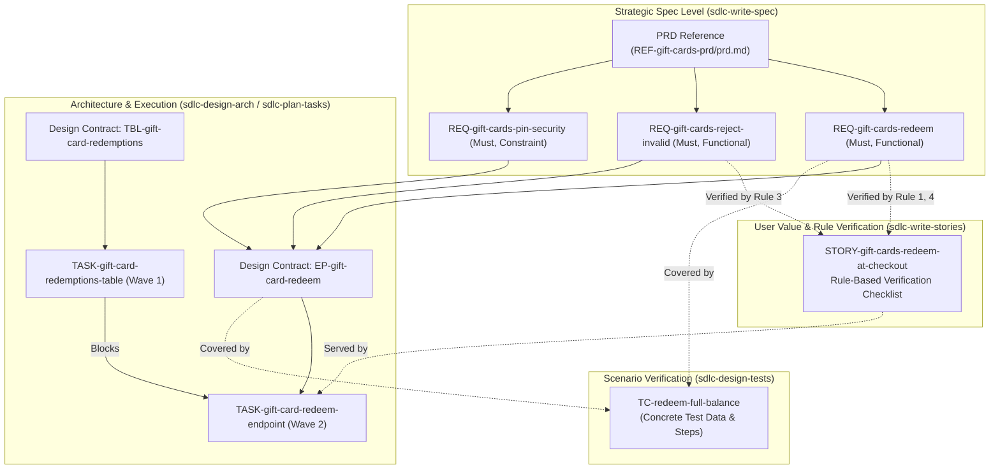

# Standard Software Industry Structures: PRD, User Story, and Task

**Document Type:** Industry Standards & Comparative Research  
**Author:** AI SDLC Research  
**Date:** October 2026  
**Status:** Approved Reference  

---

## Executive Summary

In professional software engineering, translating business objectives into shipping code relies on a three-tier decomposition hierarchy:
1. **PRD (Product Requirements Document):** Macro level — Strategic intent, customer problem, product behavior, success metrics, and boundaries (**The "Why" and "What"**).
2. **User Story:** Meso level — Vertical slices of end-user value, persona goals, and **rule-based verification checklists** (**The "Who", "What", and "Confirmation"**).
3. **Task (Engineering Task / Subtask):** Micro level — Concrete engineering work, architectural seams, schema changes, and pull request deliverables (**The "How" and Implementation**).

This document details canonical industry standards, authoritative frameworks (SVPG, Mike Cohn, Ron Jeffries, Bill Wake, Gojko Adzic, Atlassian, Shape Up), structural schemas, templates, traceability models, and how they map to AI-assisted SDLC schemas.

---

## 1. Product Requirements Document (PRD)

### 1.1 Purpose & Authority
A PRD articulates what problem a feature solves, for whom, how the product should behave from an outside-in perspective, and how success is measured.

* **Primary Authorities:**
  * **Marty Cagan / Silicon Valley Product Group (SVPG):** *Inspired: How to Create Tech Products Customers Love*. Defines the PRD's purpose as addressing four product risks before building: **Value risk**, **Usability risk**, **Feasibility risk**, and **Business Viability risk**.
  * **Lenny Rachitsky (Lenny's Newsletter):** Standardized modern lightweight 1-pagers used across Figma, Airbnb, Stripe, and Uber.
  * **Amazon Working Backwards (PR-FAQ):** Focuses on customer-centric clarity by writing the press release and FAQ first.
  * **Basecamp / Ryan Singer (*Shape Up*):** Replaces sprawling waterfall specs with bounded "Pitches" defining problem, appetite, solution, rabbit holes, and no-gos.

### 1.2 Evolution: Waterfall vs. Modern Agile PRDs
* **Traditional Antipattern (Waterfall PRD):** 50+ page document produced in isolation, specifying every database column and UI button before discovery or development begins.
* **Modern Best Practice (Living / Lean PRD):** 2–5 page collaborative document focusing strictly on **Problem**, **User Outcomes**, and **System Behavior**, leaving technical architecture to engineering.

### 1.3 Standard Industry PRD Structure

| Section | Industry Standard Content | Why It Matters |
| :--- | :--- | :--- |
| **1. Header & Metadata** | Title, Owner/Author, Tech Lead, Designer, Status (Draft/In Review/Approved), Target Milestone/Release. | Establishes single-threaded ownership and document lifecycle state. |
| **2. Executive Summary / Context** | 2–3 sentence overview of the initiative. | Enables cross-functional stakeholders to grasp intent in 30 seconds. |
| **3. Problem Statement & Evidence** | Specific user pain point, customer quotes, quantitative drop-off data, research findings. | Validates **Value Risk**; grounds the project in evidence rather than opinion. |
| **4. Goals & Success Metrics (KPIs)** | Primary outcome metric, secondary guardrail metrics, OKR alignment. | Distinguishes shipping features from delivering business outcomes. |
| **5. Target Audience & Personas** | Primary persona(s), secondary persona(s), anti-personas (who this is NOT for). | Prevents designing for a generic "everyone" user. |
| **6. Out of Scope / Non-Goals** | Explicit list of what will deliberately NOT be built in this version/release. | The primary mechanism to prevent scope creep. |
| **7. User Flows & Business Rules** | Step-by-step user journeys, domain invariants, edge/error states, UX mockups. | Validates **Usability Risk**; provides behavioral context to derive requirements and stories. |
| **8. Functional Requirements** | Prioritized list of required capabilities (MoSCoW or P0–P3), written as atomic system obligations. | Foundation for traceability, user stories, and test coverage. |
| **9. Non-Functional Requirements (NFRs)** | Performance SLAs (latency/throughput), security/auth, privacy/compliance, accessibility, availability. | Validates **Feasibility & Viability Risks**; prevents production surprises. |
| **10. Risks, Assumptions & Open Questions** | Unvalidated technical assumptions, third-party limits, pending stakeholder decisions. | Surfaces unknowns early so spikes or discovery can resolve them. |
| **11. Release & Rollout Strategy** | Phased rollout (alpha, beta, GA), feature flags, telemetry events, migration constraints. | Ensures operational readiness beyond code merging. |

### 1.4 Production Markdown Template: Modern PRD

```markdown
# [Feature Name] PRD

## Metadata
- **Author:** [Product Manager Name]
- **Engineering Lead:** [Tech Lead Name]
- **Design Lead:** [Product Designer Name]
- **Status:** Draft | ReqApproved | Approved | Released
- **Target Release:** [e.g., Q4 2026]
- **Tracking Epic:** [e.g., PROJ-1024]

---

## 1. Problem Statement & Evidence
- **Customer Problem:** [Exact problem users experience in plain English.]
- **Evidence & Data:** [e.g., 28% of cart drop-offs occur at checkout step 2; 45 support tickets in September.]
- **Strategic Fit:** [Connection to company priorities or quarterly OKRs.]

## 2. Goals & Success Metrics
- **Primary Success Metric:** [e.g., Increase checkout completion rate from 62% to 70%.]
- **Guardrail Metric:** [e.g., Payment error rate must remain < 0.1%.]

## 3. Target Audience & Personas
- **Primary Persona:** [e.g., Signed-in shopper redeeming a pre-funded gift card.]
- **Secondary Persona:** [e.g., Support agent inspecting order payment methods.]

## 4. User Flows & Business Rules
- **Happy Path Flow:**
  1. Shopper selects "Pay with Gift Card" at checkout.
  2. Shopper enters 16-digit card number and 4-digit PIN.
  3. System validates active balance and deducts up to the order total.
- **Business Rules & Edge Cases:**
  - Expired or deactivated cards are rejected without modifying cart state.
  - Partial balance coverage requires a secondary payment method for the remainder (split tender).

## 5. Requirements

### Functional Requirements
- **REQ-gift-cards-redeem (Must):** A shopper can redeem an active gift card balance against an order total. Functional. Verified by test.
- **REQ-gift-cards-reject-invalid (Must):** Checkout rejects expired, unknown, or zero-balance gift cards with a specific reason. Functional. Verified by test.
- **REQ-gift-cards-split-tender (Should):** When a gift card balance is less than the order total, checkout applies the full card balance and collects the remainder via a second payment method. Functional. Verified by test.

### Non-Functional Requirements (NFRs) & Constraints
- **REQ-gift-cards-latency (Should):** Gift card balance validation and redemption complete within 300ms at p95. Nonfunctional. Verified by test.
- **REQ-gift-cards-pin-security (Must):** Gift card PINs are never stored in plain text or written to logs. Constraint. Verified by inspection.

## 6. Out of Scope
- Physical gift card barcode scanning via device camera.
- Purchasing new gift cards (redemption only).

## 7. Risks, Assumptions & Open Questions
- **Assumptions:** Core Ledger API supports atomic balance holds.
- **Open Questions:** Legal sign-off on escheatment rules for expired cards in EU jurisdictions.
```

---

## 2. User Story

### 2.1 Purpose & Authority
A User Story captures one actor's goal and the business value it delivers, paired with **rule-based verification criteria** that define the exact conditions of satisfaction. It slices product functionality vertically across layers so each story delivers demonstrable user value.

* **Primary Authorities:**
  * **Connextra (2001) / Mike Cohn (*User Stories Applied*, 2004):** Established the canonical persona-goal-benefit template (`As a [role], I want [capability], so that [benefit]`) and rule-oriented acceptance criteria as conditions of satisfaction.
  * **Ron Jeffries (Extreme Programming - XP):** The **3 C's**:
    1. **Card:** Concise statement of who wants what and why.
    2. **Conversation:** Collaborative refinement between product, engineering, and QA.
    3. **Confirmation:** Objective acceptance criteria checklist verifying completion.
  * **Bill Wake (2003):** The **INVEST** quality model (**I**ndependent, **N**egotiable, **V**aluable, **E**stimable, **S**mall, **T**estable).
  * **Gojko Adzic (*Specification by Example*, 2011) & Atlassian Agile Coach:** Distinguish **Rule-Oriented Acceptance Criteria (Verification Checklists)**—which state invariant business rules, boundaries, and pass/fail conditions—from step-by-step test scripts.

### 2.2 Why Rule-Based Verification Checklists for User Story AC
Industry practice recognizes two formats for Acceptance Criteria: **Rule-Based Verification Checklists** and **Scenario-Based (Given/When/Then)**. In structured SDLC systems where detailed test cases (`TestCase`) already hold step-by-step inputs and execution scripts, **Rule-Based Verification Checklists** are the superior standard for User Stories:

1. **No Duplication with Test Cases:** `Given/When/Then` scenarios with concrete test data duplicate the job of QA test cases (`TestCase`). Rule checklists define *what rules must hold*, while test cases define *concrete data and steps to exercise those rules*.
2. **Higher Signal-to-Noise Ratio:** Validation rules, field constraints, permission boundaries, state transitions, and error conditions read cleanly as atomic checklist rules rather than repetitive Gherkin prose.
3. **Direct Developer & Reviewer Verification:** Engineers and PR reviewers can tick off each rule one-by-one as a binary Pass/Fail verification list before opening or approving a PR.

### 2.3 Anatomy of a Rule-Based Verification Criterion
Every item in a User Story's `# Acceptance criteria` checklist must satisfy four rules:
1. **Atomic & Binary (Pass/Fail):** States exactly one verifiable rule, constraint, or outcome that is unambiguously true or false.
2. **Concrete Thresholds & Outcomes:** Names exact boundaries, state changes, or error behaviors (e.g., *"16-digit card number and 4-digit PIN"*, *"retains remaining balance"*), never vague qualifiers (*"validates properly"*, *"user-friendly error"*).
3. **Covers Happy Path, Boundaries & Rejections:** Includes the primary success rule, boundary conditions (e.g., partial balance / split tender), and failure/rejection rules (e.g., expired card, duplicate submission).
4. **Explicit Requirement Traceability:** Ends with a direct link to the PRD Requirement(s) (`REQ-*`) that the rule verifies.

### 2.4 Strategy: How to Break User Stories from a Feature or ChangeRequest
A Feature's `# Requirements` list in `overview.md` mixes primary user actions, validation/rejection rules, optional extensions, and NFRs at the same flat level. Mapping `1 REQ = 1 Story` produces broken stories (e.g., *"Learn why a gift card is refused"*), while mapping `1 Feature = 1 Story` produces an unshippable epic.

Use this **5-Step Algorithm** to decompose a Feature or ChangeRequest into independent, Jira-ready User Stories:

#### Step 1: Classify Every `REQ-*` into One of 4 Roles
| Role Tag | Definition | Story Treatment | Example |
| :--- | :--- | :--- | :--- |
| **`[SPINE]`** | A primary user action that achieves an end-to-end goal. | Forms the core of a candidate Story. | `REQ-gift-cards-redeem`: Pay order with a gift card. |
| **`[RULE]`** | A validation, rejection, calculation, or invariant that only triggers *during* a `[SPINE]` action. | **Never its own Story** — folded into its `[SPINE]` Story as checklist items. | `REQ-gift-cards-reject-invalid`: Reject expired, unknown, or zero-balance cards. |
| **`[EXTENSION]`** | A secondary variation or capability increment on top of a `[SPINE]` that can ship in a later sprint. | Becomes a separate follow-up Story. | `REQ-gift-cards-split-tender`: Split payment across gift card + secondary method. |
| **`[NFR]`** | A `Nonfunctional` or `Constraint` requirement (latency, rate limit, security). | **Never its own Story** — attaches to the `[SPINE]` Story it constrains (or stays in Tasks if pure infra). | `REQ-gift-cards-pin-security`: Mask PIN and never log it in plain text. |

#### Step 2: Group `[SPINE]` Requirements by `Actor × Surface`
* Each `[SPINE]` requirement for a distinct **Actor + Surface** (e.g., *Shopper on Storefront* vs. *Support Agent on Admin Portal*) starts as one Story.
* **Merge two `[SPINE]` requirements** only when the same actor performs both on the same screen, at the same priority (`Must`), and one is trivial without the other (e.g., *Apply coupon* + *Clear coupon* on the same input).
* **For a ChangeRequest:** Write stories only for added/modified `Functional` `REQ-*` in the CR (`Proposed`/`ReqApproved`), linking impacted Feature stories under `# Affects`. A pure `refactor`, `perf`, or `security` CR with zero `Functional` `REQ-*` gets **0 User Stories**.

#### Step 3: Fold `[RULE]` and Observable `[NFR]` Requirements into Their `[SPINE]` Story
Attach every `[RULE]` and user-observable `[NFR]` (plus idempotency/retry guarantees) to the `[SPINE]` Story it governs, expanding them into binary pass/fail items in `# Acceptance criteria`.

#### Step 4: Split Oversized `[SPINE]` Stories Along the 5 Vertical Patterns
When a single `[SPINE]` Story is still too large for one sprint, split vertically—never horizontally by technical layer (UI vs. API vs. DB):
1. **By Rule / Calculation Type:** Basic fixed/% discount (Story 1) → BOGO / tiered discount (Story 2).
2. **By Workflow Step:** Apply gift card at checkout (Story 1) → Save gift card to account wallet (Story 2).
3. **By Input / Payment Variation:** Full-balance gift card payment (Story 1) → Split tender payment (Story 2).
4. **By CRUD Lifecycle:** Create & view (Story 1) → Edit, deactivate, or bulk-archive (Story 2).
5. **By Actor / Role:** Customer self-service (Story 1) → Support agent manual override (Story 2).

#### Step 5: Pass the 3-Question Jira Independence Gate
Every resulting Story must answer **Yes** to all three questions:
1. **Shippable & QA-Testable Alone?** If only this Story (and any base Story it extends) deploys to staging today, can a user complete a real goal and can QA pass every item on its checklist?
2. **Single Actor & Surface?** Does one persona perform this goal on one surface?
3. **Fits One Sprint (3–8 Checklist Rules)?** Can its Sub-tasks merge and verify within one sprint?

### 2.5 Standard Industry User Story Structure

| Element | Industry Standard Specification | Purpose |
| :--- | :--- | :--- |
| **Metadata** | Story Key (`STORY-*`), Parent Feature/ChangeRequest, `basedOn` spec version, Priority (`P0`–`P3`), `trackerKey`. | Backlog planning, spec version staleness detection, and tracker sync. |
| **Title** | Short, active verb phrase (e.g., "Redeem gift card at checkout"). | Scannable identification in boards and PRs. |
| **Story Statement** | `As a <persona>, I want <goal>, so that <benefit/value>.` | Anchors technical work to actor empathy and outcome value. |
| **Acceptance Criteria** | **Rule-based verification checklist**: numbered or checkbox (`- [ ]` / `1.`) pass/fail rules with concrete constraints, boundaries, and outcomes, each citing its `REQ-*`. | Defines explicit, binary conditions of satisfaction for engineers and QA. |
| **Requirements** | Explicit links to parent `REQ-*` entries in `overview.md`. | Guarantees 100% functional requirement coverage and prevents scope creep. |
| **Notes / Context** | Optional scope boundaries, UX links, or exclusions. | Captures supporting context without cluttering the verification checklist. |

### 2.6 Production Markdown Template: User Story (Rule-Based AC)

```markdown
---
type: UserStory
title: Redeem gift card at checkout
description: A customer applies an active gift card balance to pay full or partial order total.
priority: P1
basedOn: { version: 1, at: 2026-10-31 }
---

# Redeem gift card at checkout

As a **customer checking out an order**, I want to apply my gift card balance to my order total, so that I can use pre-funded store credit instead of a credit card.

# Acceptance criteria

1. [ ] Accepting a valid 16-digit gift card number and 4-digit PIN with a balance greater than or equal to the order total sets the remaining amount due to `0.00` and deducts the order total from the card balance upon order placement. ([REQ-gift-cards-redeem](overview.md#req-gift-cards-redeem))
2. [ ] Accepting a valid gift card whose balance is less than the order total applies the entire card balance to the order, sets the card balance to `0.00` upon order placement, and requires a secondary payment method for the remaining balance due. ([REQ-gift-cards-split-tender](overview.md#req-gift-cards-split-tender))
3. [ ] Submitting an expired, deactivated, unknown, or zero-balance gift card rejects the redemption, leaves the cart balance due unchanged, and displays the specific rejection reason (`expired`, `invalid card or PIN`, or `zero balance`). ([REQ-gift-cards-reject-invalid](overview.md#req-gift-cards-reject-invalid))
4. [ ] Submitting duplicate redemption requests for the same checkout session is idempotent and deducts the gift card balance at most once. ([REQ-gift-cards-redeem](overview.md#req-gift-cards-redeem))

# Requirements

* [REQ-gift-cards-redeem](overview.md#req-gift-cards-redeem)
* [REQ-gift-cards-split-tender](overview.md#req-gift-cards-split-tender)
* [REQ-gift-cards-reject-invalid](overview.md#req-gift-cards-reject-invalid)

# Notes

Physical barcode scanning via device camera is out of scope for v1.
```

---

## 3. Engineering Task (Technical Task / Subtask)

### 3.1 Purpose & Authority
An Engineering Task is an operational unit of technical execution scoped to a single repository. While a User Story articulates **user value and business rules**, a Task articulates **architecture seams, contracts, and code verification**.

* **Primary Authorities:**
  * **Scrum Guide & Extreme Programming (XP):** Decomposing stories into discrete developer tasks during planning.
  * **Bill Wake (2003):** **SMART** tasks (**S**pecific, **M**easurable, **A**chievable, **R**elevant, **T**ime-boxed).
  * **Kent Beck (*Test-Driven Development*):** Breaking changes into verifiable contract, implementation, and unit test steps.

### 3.2 Strategy: How to Break Tasks from User Stories and System Design Outcomes (Jira Tree Model)
In Jira and similar trackers, work items form a **strict 3-level tree**:
* **Epic (`FEAT-*` or `CR-*`)** → **Story (`STORY-*`)** → **Sub-task (`TASK-*` with 1 Story)**
* **Epic (`FEAT-*` or `CR-*`)** → **Technical Task / Spike (`TASK-*` with 0 Stories)**

Because a Jira Sub-task can have **at most one parent Story**, a `Task` must link **0 or 1 `UserStory`** (`# Stories` never links 2+ stories).

#### The 4-Step Task Decomposition Algorithm

1. **Step 1 — Partition by Repository (`resource`):**
   * One `Task` changes **at most one code repository** (`Service.resource`, `WebFrontend.resource`, `MobileFrontend.resource`).
   * A User Story that spans Backend (`SVC-*`) and Frontend (`WEB-*`) always splits at the repository boundary into separate Sub-tasks under that Story.

2. **Step 2 — Slice Story Sub-tasks (`1 Story`) vs. Epic Tech Tasks (`0 Stories`):**
   Use the following matrix to map every System Design concept (`# Architecture` / `## Target delta`) into Tasks:

| System Design Outcome | Bundle as a Story Sub-task (`# Stories`: 1 Story) when… | Split as an Epic Tech Task (`# Stories`: omitted) or Separate Sub-task when… |
| :--- | :--- | :--- |
| **`Database` / `Table` (`DB-*`, `TBL-*`), `Cache`, `SearchIndex`, `BlobStore`** | Used by **one** Story (or created by the first Story that ships) in the same service repo and fits within `L` alongside its `EP-*`/`SUB-*`. | Shared by **2+ parallel Stories** in the same sprint, or requires a multi-step/backfill migration with independent rollback. |
| **`ExternalService` / `Operation` (`EXT-*`, `OP-*`)** | Called by **one** Story's `EP-*` or `SUB-*` in the same repo. | Shared across multiple Stories or requires a standalone SDK/auth/circuit-breaker foundation first. |
| **`MessageChannel` (`CHAN-*`)** | Defined in the producer repo as part of one Story's vertical backend slice. | Shared event contract between multiple teams/repos that must merge in Wave 1 to unblock parallel producer/consumer work. |
| **`Endpoint` (`EP-*`) + `Service` (`SVC-*`)** | **Default `[BE]` Story Sub-task:** Implements the synchronous backend rules (`# Validations`, `# Status codes`, `# Flowchart`) for **one** `UserStory`. | Split into 2 Sub-tasks under the same Story only if the Story touches multiple complex endpoints that would exceed `L`. |
| **`Subscription` / Consumer (`SUB-*`)** | **Default `[SUB]` Story Sub-task:** Implements the async consumer (`# Validations`, `# Idempotency`, `# Failure behavior`) for **one** `UserStory` in the worker/consumer service repo. | Epic Tech Task (`0` Stories) only if the consumer handles an infrastructure/NFR stream with no user story. |
| **`WebFrontend` / `MobileFrontend` (`WEB-*`, `MB-*`)** | **Default `[FE]` Story Sub-task:** Implements routes, UI state, and `EP-*` calls for **one** `UserStory` in that frontend repo. | When 2 Stories both modify `WEB-storefront`, each Story gets its **own** `[FE]` Sub-task listing `WEB-storefront — modified` with a note on its slice. |
| **`ArchitectureDecision` (`ADR-*`) & NFRs** | Fold ADR/NFR obligations (idempotency headers, PII masking, rate limits) directly into the `# Acceptance` of the Story Sub-tasks they govern. | Create an Epic-level `spike`, observability, perf, or cleanup Task (`0` Stories) when an ADR/NFR is repo-wide or pre-dates story execution. |

3. **Step 3 — Derive Task `# Acceptance` from Story Checklist + Design Contracts:**
   Each Task's `# Acceptance` combines:
   * The subset of its parent `UserStory`'s **Rule-Based Verification Checklist** enforced by this repository.
   * All contract rules from `# Planned scope` (`EP-*` status codes/validations/flowchart exits; `SUB-*` idempotency/retries/DLQ; `TBL-*` constraints/indexes).
   * Unit and component tests required to prove those branches.

4. **Step 4 — Order into Parallel Execution Waves (`# Blocked by`):**
   * **Wave 1:** Risk spikes (`spike`), Epic-level shared foundations (`TBL-*`, `CHAN-*`, `EXT-*`), and `[BE]` Sub-tasks of base Stories that bundle their own table.
   * **Wave 2:** `[BE]` and `[SUB]` Sub-tasks blocked by Wave 1 foundations or producer endpoints.
   * **Wave 3:** `[FE]` Sub-tasks (`WEB-*` / `MB-*`) blocked by their Story's `[BE]` Sub-task, plus final cleanup/removal Tasks.

### 3.3 Standard Industry Task Structure

| Element | Industry Standard Content | Why It Matters |
| :--- | :--- | :--- |
| **1. Metadata** | Task Key (`TASK-*`), Status (`Todo`/`Done`), `basedOn` spec version, `taskType` (`dev`/`test`/`design`/`spike`), `estimate` (`XS`–`L`), `priority`, `prUrl`, `mergeCommitSha`. | Tracks execution, sizing, spec currency, and merge provenance. |
| **2. Acceptance** | Observable technical results, HTTP status codes, events emitted, error handling, unit tests required, and links to satisfied `REQ-*`. | Defines objective Definition of Done for coding and PR review. |
| **3. Stories** | Links to the `STORY-*` files in the same folder that this Task serves. | Connects code changes back to user-facing verification checklists. |
| **4. Planned Scope** | Exact Design concepts (`EP-*`, `TBL-*`, `WEB-*`) qualified as `new`, `modified`, or `removed`. | Bounds the blast radius of code changes for engineers and AI agents. |
| **5. Blocked By** | Upstream Tasks (`TASK-*`) that must merge first (e.g., schema migration before endpoint). | Enables topological sorting into parallel execution waves. |
| **6. References** | Relevant reference docs or code examples (`REF-*`) with guidance on what pattern to follow. | Prevents reinventing existing codebase patterns. |

### 3.4 Production Markdown Template: Engineering Task

```markdown
---
type: Task
title: Build gift card redeem endpoint
description: Validate gift card PIN and hold balance for checkout orders.
status: Todo
basedOn: { version: 1, at: 2026-10-31 }
taskType: dev
estimate: M
priority: P1
---

# Build gift card redeem endpoint

# Acceptance

`POST /v1/payments/gift-cards/redeem` validates the 16-digit card number and 4-digit PIN, places an atomic hold on the card balance up to the order total, returns `200` with `appliedAmountCents` and `remainingBalanceCents`, returns `422` on expired or zero-balance cards, returns `409` on conflicting duplicate `Idempotency-Key`, never logs the PIN, and includes unit tests covering each status code. Satisfies [REQ-gift-cards-redeem](overview.md#req-gift-cards-redeem), [REQ-gift-cards-reject-invalid](overview.md#req-gift-cards-reject-invalid), and [REQ-gift-cards-pin-security](overview.md#req-gift-cards-pin-security).

# Stories

* [STORY-gift-cards-redeem-at-checkout](STORY-gift-cards-redeem-at-checkout.md)

# Planned scope

* [EP-gift-card-redeem](../../services/SVC-payments/EP-gift-card-redeem.md) — new — redemption endpoint and validation rules.
* [OP-ledger-hold](../../externals/EXT-core-ledger/OP-ledger-hold.md) — new — atomic balance hold call.

# Blocked by

* [TASK-gift-card-redemptions-table](TASK-gift-card-redemptions-table.md)

# References

* [REF-idempotency-middleware](../../references/REF-idempotency-middleware/overview.md) — reuse the `Idempotency-Key` header guard; do not add a custom lock table.
```

---

## 4. Comparative Synthesis: PRD vs. User Story vs. Task (plus TestCase)

| Dimension | PRD (`prd.md` + `REQ-*`) | User Story (`STORY-*`) | Engineering Task (`TASK-*`) | Test Case (`TC-*`) |
| :--- | :--- | :--- | :--- | :--- |
| **Primary Question** | **Why** are we building this, and **what** must the system do? | **Who** benefits, **what goal** do they achieve, and **what rules verify it**? | **How** and **where** do we build and unit-test the code? | **How** do we prove the system works with concrete inputs and steps? |
| **Owner** | Product Manager / BA | Product Manager / BA | Software Engineer / Tech Lead | QA / Developer |
| **Scope Level** | Macro (Feature / ChangeRequest) | Meso (One actor goal across layers) | Micro (One repository, one PR) | Verification (One scenario / risk path) |
| **Acceptance Format** | Atomic `REQ-*` statements with MoSCoW priority, type, and verification method | **Rule-based verification checklist** (binary pass/fail rules traced to `REQ-*`) | Technical observable outcomes, contracts (`EP-*`, `TBL-*`), and unit test expectations | Concrete `# Test data` table + step-by-step `# Steps` (`Action`, `Expected result`, `Validation`) |
| **Lifecycle State** | `Draft` -> `ReqApproved` -> `Approved` -> `InDev` -> `Released` | Stateless in wiki (tracked in external issue tracker) | `Todo` -> `Done` (with `mergeCommitSha`) | Suite: `Draft` -> `Approved` -> `Implemented` |

---

## 5. Traceability Architecture



---

## 6. Industry Anti-Patterns & Failure Modes

### 6.1 PRD Anti-Patterns
1. **Architecture Hallucination:** Specifying SQL column types, internal microservices, or endpoint URLs in the PRD instead of observable behavior and constraints.
2. **Missing Non-Goals:** Omitting explicit exclusions (`Out of scope`), inviting scope creep during design and task planning.
3. **Untestable Requirements:** Compound requirements joining multiple independent behaviors with "and", or omitting priority and verification method.

### 6.2 User Story Anti-Patterns
1. **Gherkin Bloat / Test-Case Duplication:** Forcing verbose `Given/When/Then` scripts with arbitrary test literals into User Stories when `TestCase` files already own concrete test data and step tables, obscuring the core business rules.
2. **Vague Checklist Items:** Writing non-binary rules such as *"Gift card validation works properly"* or *"UI is clean"* instead of concrete pass/fail rules (*"Rejects expired cards with error message and leaves cart total unchanged"*).
3. **Horizontal Layer Stories:** Writing *"As a developer, I want a gift card database table"* — infrastructure belongs in `Task`, never `UserStory`.
4. **Gold-Plating Criteria:** Adding checklist rules in a story that no `REQ-*` in the parent Feature/ChangeRequest authorizes.

### 6.3 Task Anti-Patterns
1. **Multi-Repository Tasks:** Planning a single Task that spans backend and frontend repositories, breaking single-PR atomicity.
2. **Unbounded Scope:** Tasks without explicit Design concept links (`EP-*`, `TBL-*`, `WEB-*`) under `# Planned scope`.
3. **Missing Blocker Graph:** Failing to declare `# Blocked by` between schema/contract foundations and their consumers.

---

## 7. Primary Sources & Further Reading

1. **Silicon Valley Product Group (Marty Cagan):** *Inspired: How to Create Tech Products Customers Love* (2nd Ed., Wiley) & *"How to Write a Good PRD"*.
2. **Mike Cohn (Mountain Goat Software):** *User Stories Applied: For Agile Software Development* (Addison-Wesley, 2004).
3. **Ron Jeffries, Ann Anderson, Chet Hendrickson:** *Extreme Programming Installed* (Addison-Wesley, 2000 — The 3 C's: Card, Conversation, Confirmation).
4. **Bill Wake:** *"INVEST in Good Stories, and SMART Tasks"* (XP123, 2003).
5. **Gojko Adzic:** *Specification by Example: How Successful Teams Deliver the Right Software* (Manning, 2011 — Business rules vs. concrete examples).
6. **Atlassian Agile Coach:** *"Acceptance Criteria: Purposes, Types, Examples and Best Practices"* (Rule-oriented checklist vs. scenario-oriented formats).
7. **Ryan Singer (Basecamp):** *Shape Up: Stop Running in Circles and Ship Work that Matters* (2019).
8. **Lenny Rachitsky:** *"How to Write a PRD"* (Lenny's Newsletter).
