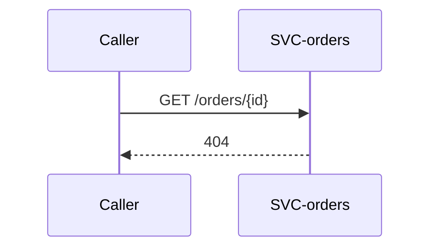

# Retire the order lookup endpoint

# Changes

* [FEAT-checkout](../../features/FEAT-checkout/overview.md)

# Reason

The storefront reads an order from the response of the order-creation request,
and no other caller is left. Rejected alternative: keeping the endpoint for
support; support reads orders in its own tool.

# Requirements

### REQ-checkout-no-direct-order-lookup

**Could** — The orders service no longer answers `GET /orders/{id}`.
Functional. Verified by inspection.

# Delta

## Target delta

* [EP-orders-get](../../services/SVC-orders/EP-orders-get.md) — removed — the lookup endpoint.

## Runtime sequences

## Decisions

None.

## Traceability

| Requirement | Target concepts |
|---|---|
| [REQ-checkout-no-direct-order-lookup](#req-checkout-no-direct-order-lookup) | [EP-orders-get](../../services/SVC-orders/EP-orders-get.md) |
