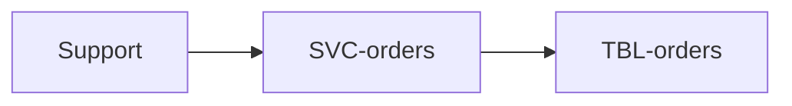
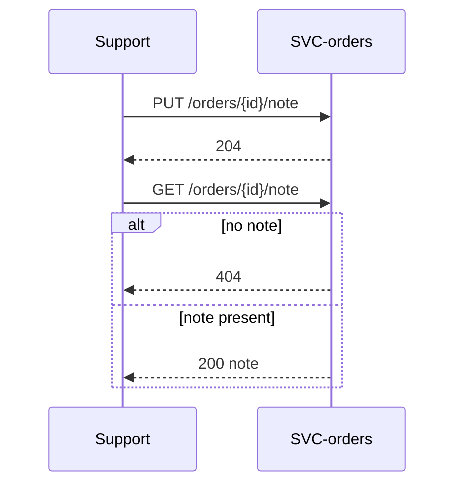

# Order notes

Support attaches a short note to an order ("customer asked for a call before
delivery") and reads it later. Owned by `checkout`. Part of the
[Shop Platform](../../overview.md).

# Requirements

### REQ-order-notes-add

**Should** — Support can attach one note of 1 to 500 characters to an order;
a second note replaces the first. Functional. Verified by test.

### REQ-order-notes-read

**Should** — Support can read the note of an order; an order with no note
answers 404. Functional. Verified by test.

# Architecture

Approved target state.

## Context and constraints

Both operations belong to the orders service, which owns the order. No new
service and no new store: the note is a column of the orders table.

## High-level architecture

## Services

* [SVC-orders](../../services/SVC-orders/overview.md) — gains two endpoints for the note.

## Runtime sequences

## Decisions

None.

## Traceability

| Requirement | Target concepts |
|---|---|
| [REQ-order-notes-add](#req-order-notes-add) | [EP-orders-note-put](../../services/SVC-orders/EP-orders-note-put.md), [TBL-orders](../../datastores/DB-shop/TBL-orders.md) |
| [REQ-order-notes-read](#req-order-notes-read) | [EP-orders-note-get](../../services/SVC-orders/EP-orders-note-get.md) |
