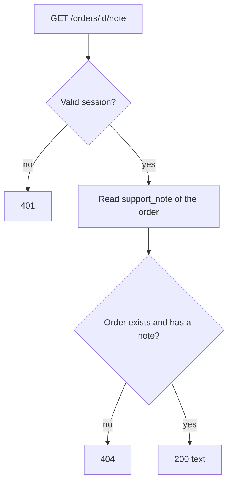
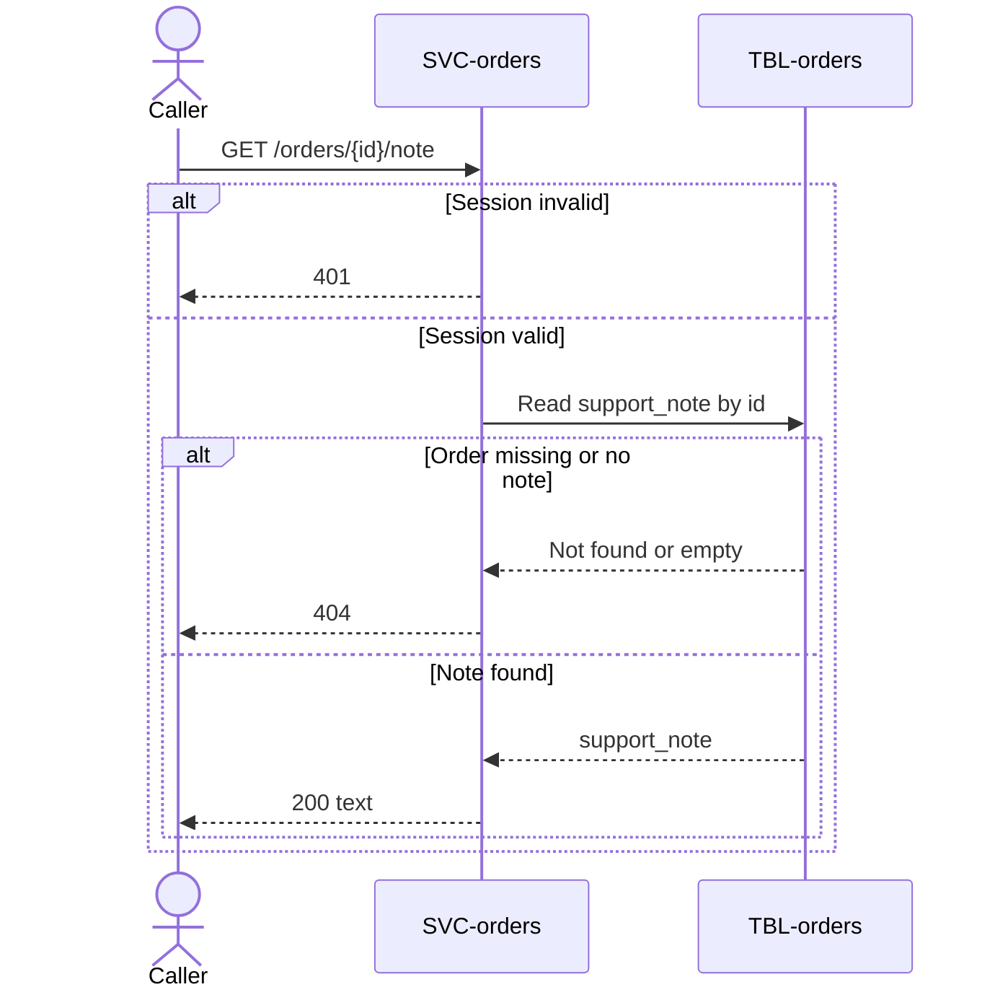

# Get Order Note

`GET /orders/{id}/note`, exposed by [SVC-orders](overview.md). Called by the
support tool.

# Request

| Field | Location | Type | Required | Description |
|---|---|---|---|---|
| `Authorization` | header | bearer token | yes | Support session token. |
| `id` | path | string (uuid) | yes | Order identifier. |

# Response

| Field | Status | Type | Required | Description |
|---|---|---|---|---|
| `text` | 200 | string | yes | The note. |

Responses `401` and `404` have no response body.

## Status codes

| Code | When |
|---|---|
| 200 | the note |
| 401 | missing or expired session |
| 404 | no such order, or the order has no note |

# Validations

| Rule | Fails with |
|---|---|
| `Authorization` carries a valid session | `401` |
| The order exists and has a note | `404` |

# Behavior

1. Read `support_note` of the [order](../../datastores/DB-shop/TBL-orders.md).
2. Answer `404` when there is none.

# Flowchart

# Sequence diagram

# Pending changes

* [FEAT-order-notes](../../features/FEAT-order-notes/overview.md) — new — the endpoint is not built yet.
