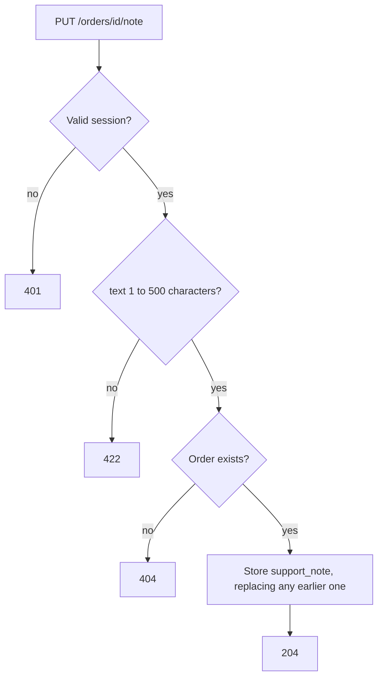
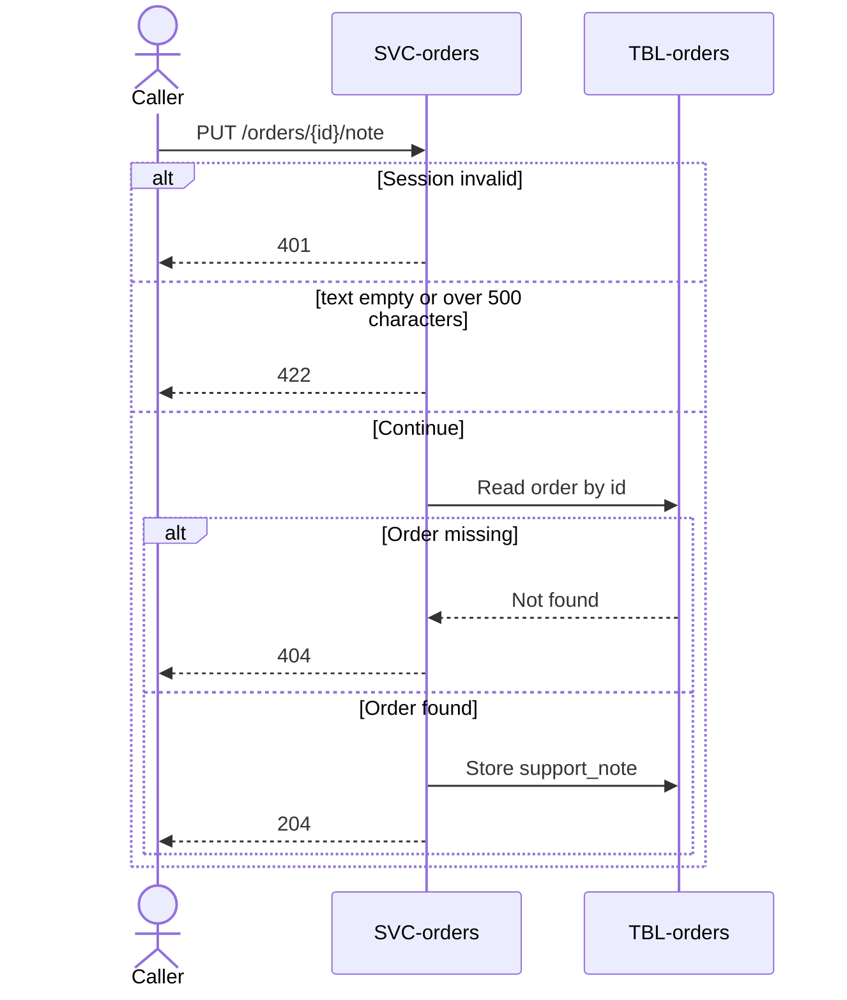

# Put Order Note

`PUT /orders/{id}/note`, exposed by [SVC-orders](overview.md). Called by the
support tool.

# Request

| Field | Location | Type | Required | Description |
|---|---|---|---|---|
| `Authorization` | header | bearer token | yes | Support session token. |
| `id` | path | string (uuid) | yes | Order identifier. |
| `text` | body | string | yes | The note; 1 to 500 characters. |

# Response

The response has no body.

## Status codes

| Code | When |
|---|---|
| 204 | note stored |
| 401 | missing or expired session |
| 404 | no such order |
| 422 | `text` empty or longer than 500 characters |

# Validations

| Rule | Fails with |
|---|---|
| `Authorization` carries a valid session | `401` |
| `text` is 1 to 500 characters | `422` |
| The order exists | `404` |

# Behavior

1. Read the [order](../../datastores/DB-shop/TBL-orders.md).
2. Store the note in `support_note`, replacing an earlier one.

# Flowchart

# Sequence diagram

# Pending changes

* [FEAT-order-notes](../../features/FEAT-order-notes/overview.md) — new — the endpoint is not built yet.
