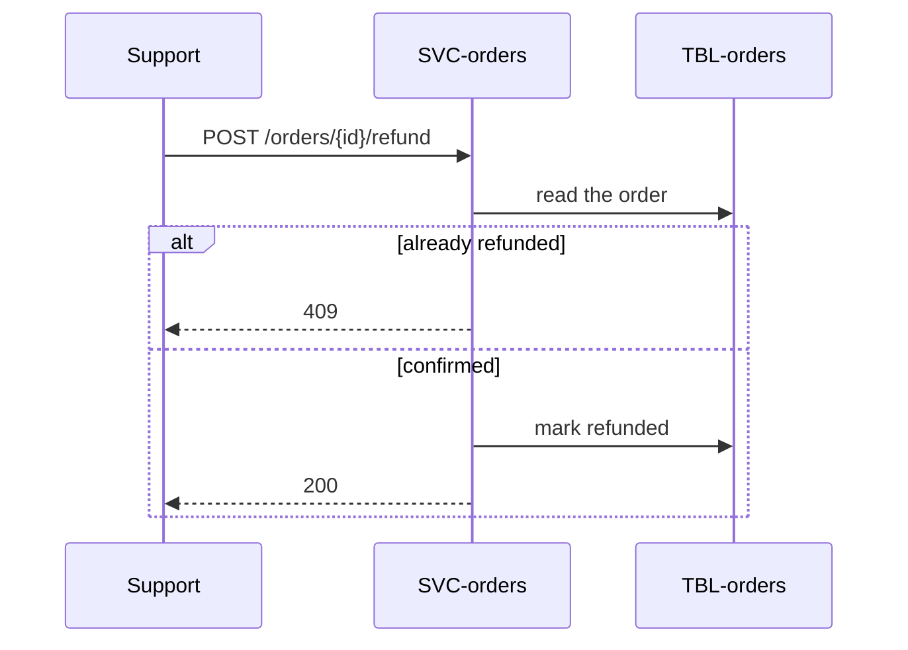

# Refund a confirmed order

# Changes

* [FEAT-checkout](../../features/FEAT-checkout/overview.md)

# Reason

Support refunds orders by hand in the payment provider's dashboard, and the
shop never learns of it. Rejected alternative: a partial refund; nobody asked
for one.

# Requirements

### REQ-checkout-refund-order

**Should** — A confirmed order can be refunded in full, once, with a reason.
A second refund of the same order is refused. Functional. Verified by test.

# Delta

## Target delta

* [EP-orders-refund](../../services/SVC-orders/EP-orders-refund.md) — new — the refund endpoint.

## Runtime sequences

## Decisions

None.

## Traceability

| Requirement | Target concepts |
|---|---|
| [REQ-checkout-refund-order](#req-checkout-refund-order) | [EP-orders-refund](../../services/SVC-orders/EP-orders-refund.md) |
