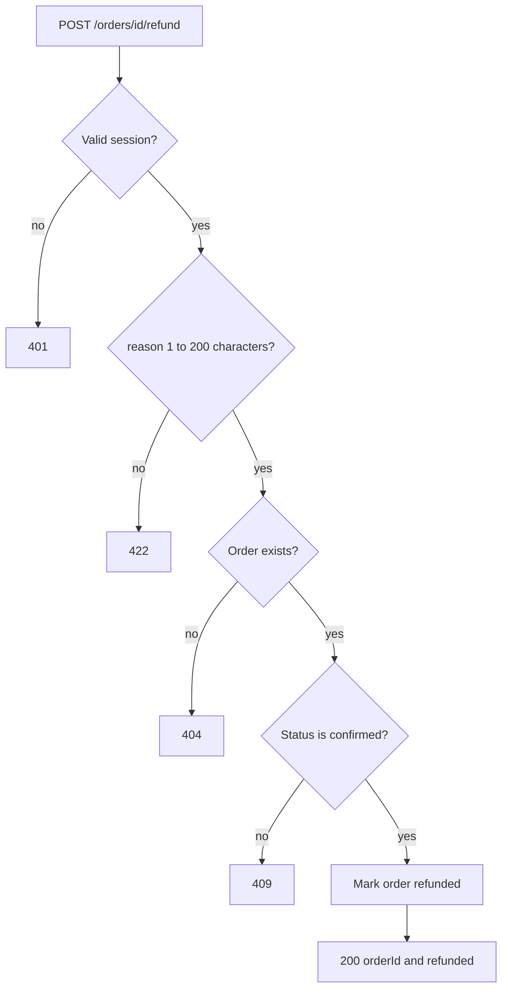
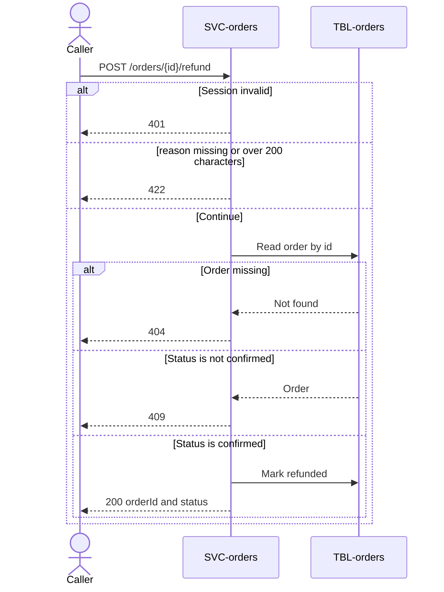

# Refund Order

`POST /orders/{id}/refund`, exposed by [SVC-orders](overview.md). Called by the
support tool.

# Request

| Field | Location | Type | Required | Description |
|---|---|---|---|---|
| `Authorization` | header | bearer token | yes | Support session token. |
| `id` | path | string (uuid) | yes | Order identifier. |
| `reason` | body | string | yes | Why the order is refunded; 1 to 200 characters. |

# Response

| Field | Status | Type | Required | Description |
|---|---|---|---|---|
| `orderId` | 200 | string (uuid) | yes | The refunded order. |
| `status` | 200 | string | yes | Always `refunded`. |

Responses `401`, `404`, `409` and `422` have no response body.

## Status codes

| Code | When |
|---|---|
| 200 | order refunded |
| 401 | missing or expired session |
| 404 | no such order |
| 409 | the order is not confirmed, or is already refunded |
| 422 | `reason` missing or longer than 200 characters |

# Validations

| Rule | Fails with |
|---|---|
| `Authorization` carries a valid session | `401` |
| `reason` is 1 to 200 characters | `422` |
| The order exists | `404` |
| The order status is `confirmed` | `409` |

# Behavior

1. Read the [order](../../datastores/DB-shop/TBL-orders.md).
2. Refuse with `409` unless its status is `confirmed`.
3. Mark the order `refunded`.

# Flowchart

# Sequence diagram

# Pending changes

* [CR-order-refund](../../change-requests/CR-order-refund/overview.md) — new — the refund endpoint is not built yet.
